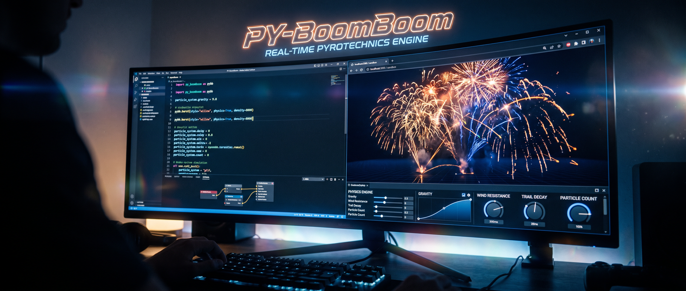
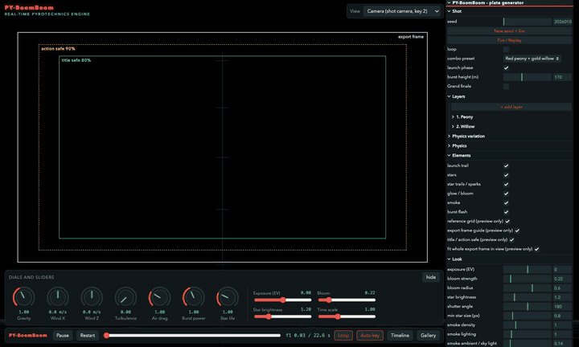
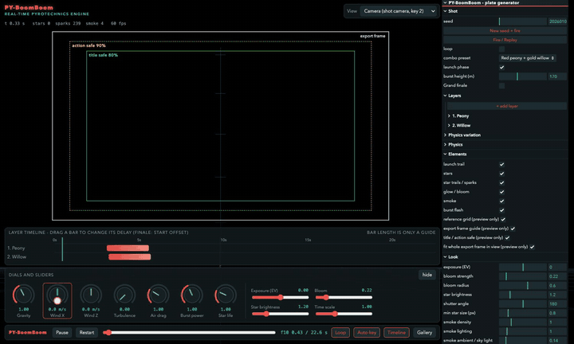
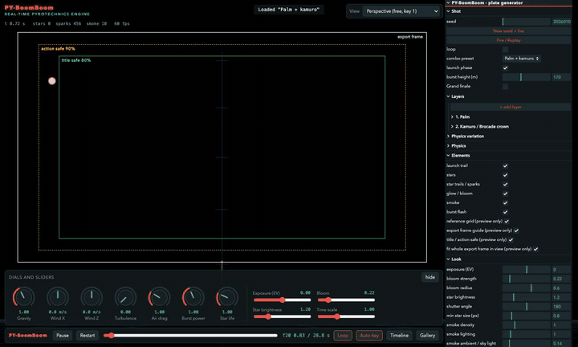
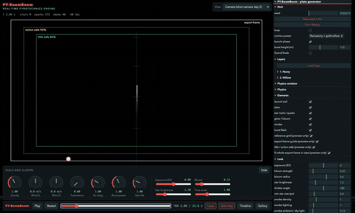
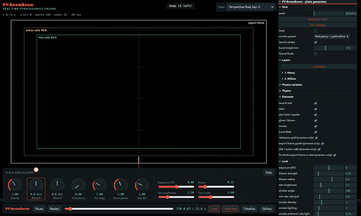
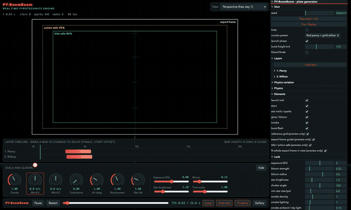

# PY-BoomBoom: Fireworks plate generator

Local, interactive fireworks VFX generator for producing individual photoreal firework "clean plates" (element on black, with alpha) to layer in Nuke / After Effects.
All imagery is procedural particle simulation + shader output. There are no AI-generated images/video and no external image or video assets; sprites and noise are generated in code.

## Run
The easy way uses [just](https://github.com/casey/just):
```
just install       # once
just start         # starts the server in the background and prints a link to click
just stop          # stops it
```
`just start` prints `http://localhost:5317/`. Click it, or copy it into your browser. Use `just status` to see if the server runs. Use `FW_PORT=5400 just start` for another port.

Without `just`:
```
npm install
npm start          # http://127.0.0.1:5317  (Vite dev server + export middleware, one process)
npm run verify     # headless Chrome verification -> verification/ (report.json, stills, test export)
npm run verify:ui  # checks the dials, scrub bar, timeline, undo, gallery, keys and Blender camera in the browser
npm run verify:blender  # checks the camera exchange with a real Blender (needs Blender)
npm run gifs       # makes the demo GIFs in docs/gifs/
npm run loops      # makes the gallery rollover loops in public/preset-loops/
```
Requires Chrome (WebGL2 with float render targets) and `ffmpeg` on PATH (or `/opt/homebrew/bin`, or `FFMPEG_PATH`). If ffmpeg is missing the UI shows an error banner and Export fails with a clear message.

### If the page shows an error banner (or looks empty)
The app shows a red banner with the error and what to do instead of a blank page. The usual cause is a browser without hardware-accelerated WebGL2: in Chrome enable Settings > System > "Use graphics acceleration when available", restart Chrome and check that `chrome://gpu` lists "WebGL2: Hardware accelerated". Float render targets are required; where only half-float is available the app falls back to half-float readback (add `?half` to the URL to force that path). `npm start` prints the URL to open; both `http://localhost:5317/` and `http://127.0.0.1:5317/` work, and the server only listens on the loopback interface. On first load a shot fires automatically and starts about a second before its burst.

## Screen controls
PY-BoomBoom has tools that make a shot faster. Press `?` in the app to see all keys.

### Dials and sliders
Use a dial to change a value fast. Drag the dial up or down. Use the mouse wheel or the arrow keys for small steps. Hold `Shift` for finer steps. Double-click a dial to reset it.
The dials and the panel sliders always show the same values.



### Scrub bar and layer timeline
Drag the scrub bar to see any moment of the shot. The simulation only runs forward. When you go back, the app fires the shot again and runs to that time. The result is the same as going forward.
Press `T` to open the layer timeline. Drag a bar to move a layer in time. In a finale, the bar changes the start offset. The bar length is only a guide.



### Undo, redo, and A/B compare
Press `Ctrl+Z` (`Cmd+Z` on Mac) to undo. Press `Ctrl+Shift+Z` to redo. The app keeps up to 100 steps.
Press `B` to store the current look in slot B. Change the look. Press `X` to flip between look A and look B.



### Preset gallery
Press `G` to open the gallery. Each card shows a picture of the preset. Move the pointer over a card to play a short loop. Type in the search box or click a tag to filter. Click a card to load it.
The built-in presets use pre-rendered loops in `public/preset-loops/`. They take almost no memory. Run `npm run loops` after you change a built-in preset. Your saved presets have no pre-rendered loop. They play live, one card at a time.



### Title safe and action safe
The safe lines are on by default. Press `V` to hide or show them. The viewport shows the whole export frame, fitted into the free area. The bright line is the edge of the export frame. Everything outside the frame is dimmed, because it is not exported. The yellow dashed line is action safe (90 %). The green line is title safe (80 %). Keep titles inside the green line, so no screen cuts them off.
The lines are only a preview. They are not in the export. The frame has the aspect of the export size.



### Camera animation
The camera you look through has two views. Press `1` for the Perspective view (a free camera). Press `2` for the Camera view (the shot camera). `C` switches between them.
The **View menu** at the top of the viewport has the Camera view (the shot camera), the Perspective view (a free camera), and the built-in views (Default, Front, Low angle, Close, Wide, Finale wide, Side). A built-in view puts the free camera there and leaves the Camera view. Your camera keys stay as they are. When you set a camera key, the viewport switches to the Camera view for you.

You animate the way you do in an animation program:
1. Move the playhead to a frame. Drag the scrub bar, or press `Left` and `Right` (1 frame) or `Home`.
2. Set a key with `K` (or `I`, or the button "Key camera here"). The key holds position, target, focal length, and roll. It sits on the frame you see.
3. Move the playhead to another frame. In the Camera view, orbit, pan, zoom, fly, or change a number. With **Auto-key** on (the default), every finished move sets a key on that frame.
4. Play. The camera follows the keys. Between the keys the camera moves on a smooth curve.

- **Auto-key off:** your move is not keyed. The camera fields turn red. The camera stays where you put it. Press `K` to key it, or move the playhead to drop it.
- **Field colours** (Camera view): orange = a key is on this frame, green = animated, red = changed but not keyed.
- `Up` and `Down` go to the previous and next key. `Delete` deletes the selected key. `Esc` deselects.
- Keys sit on whole frames. The playhead rests on a whole frame when you pause, scrub, or step.
- Each key has frame, focal length, roll, position, target, ease, and path type (smooth curve or straight). New keys copy the ease and path type of the key before. The default ease is linear, so the camera does not stop at every key. Two equal keys in a row hold the pose.
- The timeline (`T`) shows the keys as diamonds. Drag a diamond to move it (it snaps to frames). Drag the ruler to move the playhead.
- Playback stops at the end of the shot, unless loop is on.
- Time is in output seconds. Frame N of the export is at N divided by the frame rate. With a time scale of 0.5, the playhead runs at half speed, and the keys stay at output time.
- The export always uses the camera keys when keys exist. The label on the frame tells you which camera you see.
- Camera keys are part of undo and redo. They are not saved in presets. Send the camera to Blender to keep it in a file.
- The camera has no motion blur. The shutter angle only blurs the particles.



### Sliding numbers
Drag the name of any number in the panel to change it. Drag right or up to raise the number. Drag left or down to lower it. Hold `Shift` for fine steps. Hold `Ctrl` or `Cmd` for big steps. A click without movement changes nothing. You can still type a number or drag the slider.

### Blender camera
You can move one still camera between PY-BoomBoom and Blender. The file format is glTF (`.gltf` or `.glb`). Blender changes the axes for you.
- **To Blender:** open the Camera folder, then "Blender camera (glTF)". Click "Send camera to Blender". The app saves `py-boomboom-camera.glb`. In Blender, use File > Import > glTF 2.0. With a camera animation, the file holds one pose for each export frame.
- **From Blender:** in Blender, use File > Export > glTF 2.0. Set the format to "glTF Binary (.glb)". Open the Include section. Tick Cameras. A `.gltf` file with a separate `.bin` file does not load. In the app, click "Get camera from Blender".
- The file keeps position, direction, roll, and field of view. The app uses a 20.25 mm sensor height, so the focal length in Blender can look different. The picture is the same.
- **Blender helper scripts:** click "Get Blender script: load camera" and "Get Blender script: save camera". In Blender, open the Scripting workspace, open the script, and click Run Script.
  - The load script sets the frame rate, the picture size, and the frame range. It makes the camera active, and it keys the lens for every frame. Use it for animated cameras.
  - The save script writes the active camera, with its lens animation, as a `.glb` that PY-BoomBoom reads.
- **Frame rate:** without the load script, set the Blender frame rate to the export frame rate (24 fps by default). Then frame N in Blender is frame N in PY-BoomBoom.
- An imported animation plays back frame by frame. You can convert it to about 30 keys. That is an approximation.
- glTF cannot animate the field of view. The file keeps it in extra data. The load script turns it into lens keys in Blender. The plain File > Import in Blender ignores it and uses one lens.
- Not supported yet: follow-object targets, camera shake, and a curve editor for eases.
- `npm run verify:blender` checks this with a real Blender in the background. Set `BLENDER_PATH` if Blender is not in `/Applications`.

### Keyboard shortcuts
| Key | Action |
| --- | --- |
| `Space` | Play or pause |
| `F` | Fire the shot again |
| `Left` / `Right` | Step 1 frame back or forward (`Shift`: 10 frames) |
| `Up` / `Down` | Go to the previous or next camera key |
| `Home` / `End` | Go to the start or the end |
| `L` | Loop on or off |
| `Ctrl/Cmd+Z`, `Ctrl/Cmd+Shift+Z` | Undo, redo |
| `B`, `X` | Store look in slot B, flip A and B |
| `K` or `I` | Set a camera key on this frame |
| `1` / `2` / `C` | Perspective view, Camera view, switch |
| `Delete`, `Esc` | Delete the selected key, deselect |
| `T`, `G`, `H`, `V` | Timeline, gallery, hide or show the dial deck, safe lines |
| `?` | Show the key list |

Free-fly camera mode uses `W A S D Q E`. No shortcut uses these keys.

The colour palette is "Crimson and Teal": crimson `#ee4f48` for actions and keys, teal `#37c3b3` for values and key diamonds, on near-black slate `#0c1012` and `#12181b`. The font and the logo are still a draft. The brand is not final.

## Layers, colours and combos
Every shot is a list of layers; every layer can be recoloured, muted or removed, including layers that came from a combo preset (presets only fill in values; nothing is locked). Colours per layer: each type exposes the components it has, each with a palette list plus a custom colour picker:
- **colour** (all types), **secondary colour** (Pistil core, Saturn core, Crossette children - blank means "same as parent", Dahlia shift-to colour, Dragon Eggs pop colour), **trail colour** (types with spark trails; "Default" keeps the type's own trail colour).
- Horsetail, Waterfall, Crackle and Dragon Eggs are separate types; "Horsetail + Waterfall" and "Crackle + Dragon Eggs" are combo presets that load as two ordinary layers.
- Launch style per layer ("none" has no ground flash either; "dark fast shell" bursts sooner, still climbing; the tails of the other styles wander slightly, and the spiral's spin rate, radius, gusts and spark shedding drift, so every twirl is different): gold comet (default), silver tail, spiral / twirl (the tail corkscrews and is buffeted), crackling tail, dark fast shell (faint ember only) and none (invisible until the burst); "launch wobble" adds irregularity to any style. Without a finale all layers share one shell, which uses the first enabled layer's style.

## Launch speed
Shells do not all take the same time from ground to burst. Every type has a built-in launch speed (heavy, large-payload shells rise slower: Kamuro 0.75, Waterfall 0.75, Willow 0.8, Horsetail 0.8, Palm 0.8, Dahlia 0.85; light ones rise quicker: Crackle 1.3, Spider 1.25, Ring 1.2, Strobe 1.15, Peony 1.1), and each layer has a **launch speed x** control (0.4-2.5, default 1) that multiplies it ("dark fast shell" adds a further x1.8). Higher = the shell reaches its burst height sooner. It is physical, not a time scale: a faster shell leaves with a larger initial velocity (solved on the same drag + gravity model the simulation uses), is still moving fast when it bursts (its residual velocity is inherited by the stars, so they drift slightly upward), leaves a longer streak and sheds more sparks; the slowest possible shell (multiplier up to about 0.62, so several values at the low end are identical) just reaches the burst height at its apex and bursts nearly stationary. The burst height does not change (it stays at the height you set, as before about 3 % above it). The layer folder shows the resulting **ground-to-burst time** read-only. With launch phase off the speed is ignored (bursts follow the schedule directly).
- In a shot without finale all layers share one shell, which uses the **first enabled layer's launch speed** (and style).
- In a finale each launch has its own shell; "Physics variation" has a fifth amount, **launch speed (%)** (default 8 %, seeded per launch like the others). In finale mode it is always applied, so repeats of a layer do not all take the same time; single shots are exact. Finale timing is still defined by launch time (total time = first to last launch), so speed differences show up as differing burst times. The export duration estimate uses the slowest possible flight (lowest variation).
- Saved shots and presets store `launchSpeed` per layer and `variation.launchSpeed`; files written before this feature load with 1 and 8 %.

**What changed for existing seeds:** a layer now rises with its type's built-in speed, so shells burst earlier than before (for example a Chrysanthemum 3.4 s instead of 5.5 s at 170 m); the burst height is unchanged. The tail sparks use their own random stream (a shell's lateral wobble no longer depends on how many sparks it shed), which shifts the sideways drift of every launch-phase shot slightly. Layers set to launch speed 0.4 reproduce the old apex timing. Shots with launch phase off are unchanged; for launch-phase shots the random draws of stars, trails, smoke, the finale schedule and the launch positions are unchanged (stars start from a different burst time and shell velocity, which is what the changed flight physically implies).

## Grand finale
Tick **Grand finale** in the Shot folder (off = the app behaves exactly as before). Each layer then launches `repeats` times (1-20, hard-limited to 20), every launch with its own position and its own RNG streams. Stream seeds are `mix32(seed, layer id, launch index, tag)` and the per-particle randomness of stars (trail sparks, star smoke, pops, splits) is derived from the launch seed, the particle's serial number and the step, not from pool order, so adding, removing or editing another layer never changes this layer's stars, sparks, pops or smoke (checked in `verify`). Layer ids are fixed 1..n in built-in presets, unique within a shot, and invalid, duplicated or non-integer ids in a loaded file are reassigned; unknown layer types in a file are skipped with a notice (and a shot with no usable layer is not applied).
- **total time** is the span from the FIRST launch to the LAST launch, not the video length. A shell takes its flight time to burst, and the video (auto duration) continues until the last firework and its smoke have died, so 10 s of total time can give 30+ s of video. With launch phase off, the same schedule applies to burst times.
- Per layer: **repeats**, **interval** (0 = auto: launches spread evenly from the start offset to the total time; a manual value overrides it and may run past the total time), **start offset**, **interval noise** (0-1 seeded jitter of each launch time).
- Footprint: **spread X / spread Z** (metres, a launch lands uniformly inside +-spread/2 around the base point), **position seed** (a different seed gives a different set of positions), **burst height variation**; the per-layer offset still applies on top. Use the "Finale wide" camera view.
- **Finale presets** (Shot > Grand finale > Finale presets): load, save (name field), update the selected one with the current settings, delete. A preset stores the whole shot (all layers with colours, sizes, repeats, intervals, noise, offsets, launch styles, finale timing/position, seeds, physics variation). Saved presets live on disk in `presets/finales/<name>.json` (set `FW_PRESETS_DIR` to use another folder; `npm run verify` does, so it never touches your presets). Saving under an existing name (case-insensitive) asks before overwriting; "Update selected preset" is the explicit overwrite. A preset file that cannot be read is moved to `<file>.bad-<timestamp>` and you are told, it is never silently overwritten. Names keep letters and digits of any script, may be at most 60 characters and cannot start with a dot; three built-in presets ship in code (`src/library/finales.js`) and are read-only.
- Capacity: the light pool grows on demand up to 1.6 M particles and the smoke pool up to 400 k puffs (both shrink back when the shot is reset or an export ends); the HUD and the export result report anything that was dropped. The interactive preview thins out sparks (brightened to compensate) for very large scenes; exports always use every particle.

## Physics variation
**Shot > Physics variation** (shown with more than one layer or a finale): "randomise physics per launch" gives every launch (every layer / repeat) its own seeded multipliers around the global Physics values for burst velocity, star lifetime, smoke amount and smoke lifetime, each with its own amount (0-100 %) and a variation seed.

## Saved camera presets
Camera > Saved camera presets: name field, Save, dropdown, Load, Update (overwrite the selected one with the current view), Delete. A preset stores position, orientation (target and quaternion), focal length and control mode, so loading reproduces the exact framing. They are saved on disk in `presets/cameras.json` (atomic writes, same header/Origin protection as the export API, sanitised names), so they survive browsers, profiles and sessions and can be copied with the project. The built-in views are fixed.

## Controls
- Mouse: left-drag orbit, right-drag pan, wheel dolly. Camera folder: free-fly mode (WASD move, Q/E down/up, Shift fast, drag to look), numeric position/target/focal length, view presets, reset.
- Shot: seed, "New seed + fire", "Fire / Replay", loop, combo presets, launch phase on/off, burst height, and a layer list (type, palette, expanse, star count, brightness, delay, X/Y/Z offset, on/off, add/remove). Layers fire together or staggered from the same shell.
- Physics: burst velocity, drag, gravity, spread/jitter, wind X/Z, turbulence, star lifetime, time scale, smoke lifetime/amount. Burst-time values affect the next Fire; gravity, wind and turbulence act live.
- Elements: launch trail, stars, star trails/sparks, glow/bloom, smoke, burst flash, plus preview-only grid and export-frame guide (never exported).
- Look: exposure (EV), bloom strength/radius, star brightness, shutter angle, minimum star size, smoke density/lighting.
- `window.__fw`: `loadShot`, `fire`, `stepTo`, `setCamera`, `setToggle`, `getStats`, `grab`, `exportShot` (used by `scripts/verify.mjs`).

Smoke: every star leaves its own small puff where it burns out, pops or splits (Strobe stars leave a field of separate puffs after the strobing stops), plus the burst cloud and star-path wisps; the lighting field is diffused from all current emitters, so smoke from earlier shells is lit by later bursts.

Scale is metres and seconds; the sim steps at a fixed 1/120 s with a seeded RNG, independent of wall-clock time, so preview and export of one seed match. Camera: vertical FOV from focal length on a 20.25 mm tall sensor (36 mm wide at 16:9); the export uses exactly the current camera.

## Export
Export folder: resolution, fps (24/25/30/60), duration (0 = auto: until everything incl. smoke has died, at most 600 s; 1-600 s fixed), motion-blur samples (1/4/8 sub-frames averaged in HDR), alpha mode, format, name. Output goes to `exports/<name>/` (never overwritten: an existing name becomes `take02`, `name_02`, ...; the UI shows the final name). Files are written to `<name>.partial/` and renamed when ffmpeg finished cleanly. Contents: `<name>.mov` (ProRes 4444) and/or `png/<name>_%05d.png` (16-bit). "Save still" writes a 16-bit PNG to `exports/stills/`.
Before an export starts, the Export button shows an estimate of its length, frame count and disk size (a 4K 16-bit PNG sequence of a long finale can be hundreds of GB) and asks for confirmation when it is large (over 2 GB, 120 s or 5000 frames). The estimate is the last scheduled launch plus flight time plus the longest star, trail and smoke life of the layers (with the physics multipliers). If an auto-duration export reaches the 600 s cap before the world has finished, or any particles / smoke puffs / render instances had to be dropped, the result message says so.
Frames are rendered offline at export size (independent of window), snapshotted at export start (editing sliders mid-export has no effect), read back as float and sent as 16-bit RGBA to ffmpeg.

### What is in the files
- Pixel values are **sRGB-encoded** (ACES-style tone map, then the sRGB transfer; ffprobe shows `bt709` primaries and matrix, `iec61966-2-1` transfer, `tv` range). In the premultiplied modes the RGB is **premultiplied in linear light**: linear RGB is the light emitted/scattered and alpha is coverage; the sRGB encoding is applied afterwards to that premultiplied value.
- **Precision:** the **PNG sequence (16-bit RGBA) is the full-precision master.** ProRes 4444 here is effectively **10-bit** (1024 levels) per channel including alpha (ffmpeg decodes it as `yuva444p12le`, but the data is 10-bit), and it is lossy and goes through YCbCr; use it for convenience and previews.
- Alpha modes (Export > alpha mode):
  1. **RGBA premultiplied - luminance alpha** (default): alpha = max(smoke coverage, brightest linear channel of the tone-mapped image), faded to 0 below 1/1024. Light holds out the background about as much as it adds, so a normal Over composite looks close to the preview.
  2. **RGBA premultiplied - smoke-only alpha**: emissive light has alpha 0; only smoke has coverage. Comp with **Over (element over plate)**: stars then add exactly like Plus while smoke correctly holds out the plate. Do not use Plus/Add with this mode (it drops the smoke holdout).
  3. **RGB on solid black**: alpha = 1. Comp with **Screen** or **Plus/Add**; smoke then adds light too.
- The frame corners are exactly 0 (RGB and alpha). Very wide glare can leave tiny non-zero alpha away from the stars (see `verification/report.json` for measured coverage).

### Comp settings
These recipes are derived from how the files are written; **they have not been tested inside Nuke or After Effects.**
- **Nuke** (premultiplied modes 1 and 2): Read colourspace `sRGB`, **premultiplied unchecked** (the encoding was applied after premultiplication, so the sRGB-to-linear conversion must act directly on the file values; with the box checked Nuke would unpremult before converting and darken edges). Comp with **Merge (over)**: **A = the firework element, B = the background plate** (Nuke treats the image as premultiplied in the Merge). For mode 3 use **Merge (plus)** (linear) or **screen**, ignore alpha.
- **After Effects:** AE un-premultiplies in encoded space when it interprets alpha, which is not exact for this data (premultiplication happened in linear light). Recommended route: export **"RGB on solid black"**, use a linear-light project (32 bpc, linearized working space with a linear sRGB/Rec.709 profile, footage interpreted as sRGB IEC61966-2.1), and set the layer blend mode to **Add**. The premultiplied RGBA files are intended for linear, premult-aware comps such as Nuke.

### Orientation of Ring / Saturn
Rings are a world-space property: the ring normal is tilted from world +Z (the default view axis, the direction the default camera looks along) by the layer's `tilt`, then rolled about +Z by `rotation`. Orbiting the camera shows the ring from other angles (including edge-on from the side), as a real 3D element would. The default Ring/Saturn layer uses tilt 40 / rotation 180, which tips the ring toward the default camera so it reads as a ring from the default view. "random tilt" picks a seeded 20-60 degree tilt from +Z and a random roll; this is relative to world +Z, not to the camera.

## Adding a firework type
Create `src/library/mytype.js`, then import it and add it to `LIST` in `src/library/index.js`:
```js
import { trail } from './common.js';
export default {
  id: 'mytype', name: 'My type', palette: 'Gold', best: 2.5, // best: seconds after burst for the contact sheet
  burst(c) {
    c.stars({ n: 300, radius: 60, k: 0.04, life: [3, 4], size: 0.13, inten: 20, trail: trail('gold') });
  },
};
```
`radius` is the approximate radius (m) reached after ~`T` s (default 2.2); the sim derives burst speed from it and the drag `k`. Other options: `dirs` ('sphere'|'ring'|'cone'|function), `shift` (colour change), `strobe`, `grav`, `smoke`, `event` (`split` cross/sphere, `pop` crackle), `palette`, `jitter`. Palettes live in `src/library/palettes.js`.

## Adjusting physics
Per particle: gravity, quadratic drag `a = -k|v-wind|(v-wind)` with per-star drag variation, optional turbulence. Use the Physics folder for global multipliers; per-type drag `k`, `grav`, `life` in the type file; trail presets in `src/library/common.js`.

Note on slow motion: the sim always steps at a fixed 1/120 s so results are identical between preview and export. At time scales well below 1 several output frames fall inside one sim step; motion is extrapolated smoothly, but trail-spark spawning and flicker then update in 1/120 s (sim time) increments.

## Grand finale starter presets
Five ready-made finale presets ship in `presets/finales/` (Shot > Grand finale > Finale presets: Load, then edit and Update). "Total time" is first launch to last launch.
- **Fourth of July** (10 s): red, white and blue peonies, chrysanthemums, strobes, crackle and rings on fast gold/silver comets, ending in overlapping big red/white/blue breaks.
- **Concert Finale** (10 s): tight, rhythmic stadium volleys in magenta, violet and cyan-like colours with white strobe, crackle, spider and palm, ending in one wide simultaneous salvo.
- **New Years Eve** (15 s): gold, silver and champagne-white elegance that builds from sparse to dense (glitter, kamuro, willow, strobe), peaking in one huge gold kamuro at midnight.
- **Theme Park Magic** (20 s): wide, playful, full-colour storybook finale with rings, Saturns, pistils, dahlias and spiral launches, closing in a multi-colour burst under a gold crown.
- **Hanabi Festival** (20 s): few large, round shells with long pauses, slow heavy launches and hanging willows, closing with several huge overlapping gold willows and kamuro.
